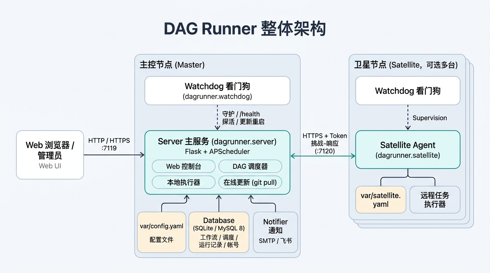
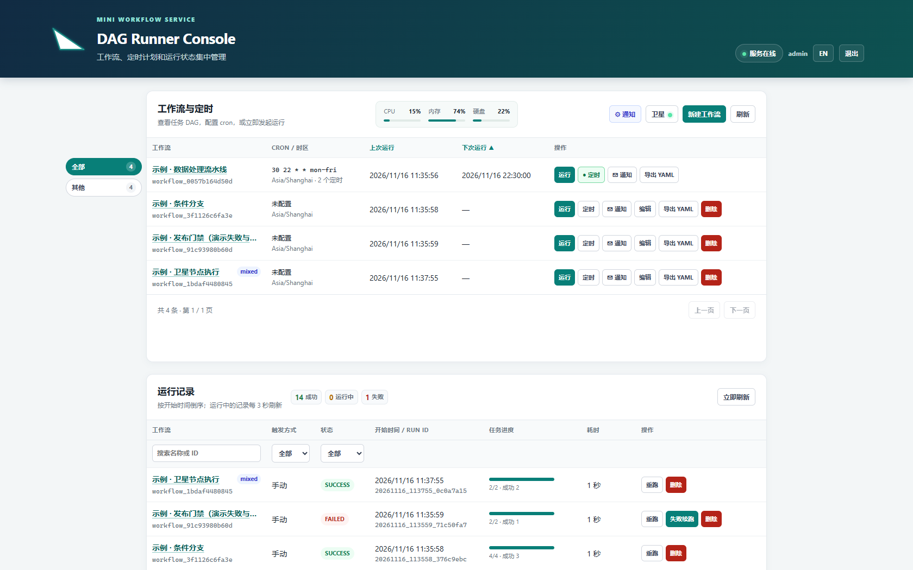
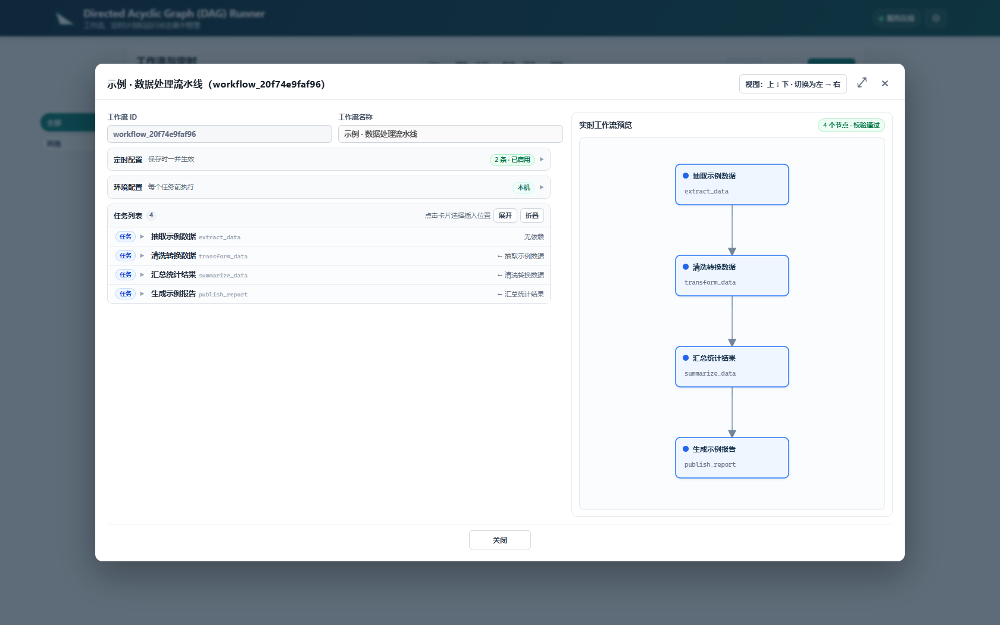
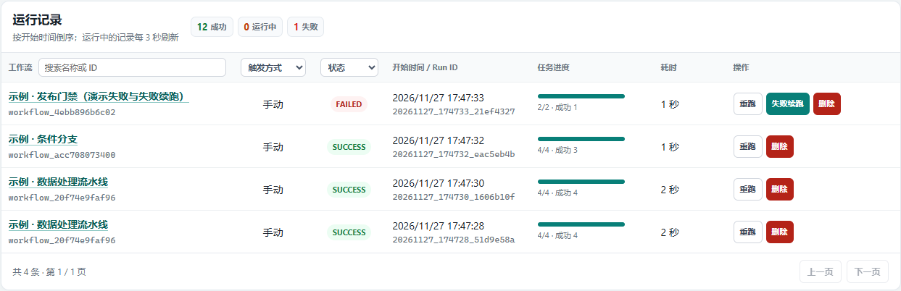
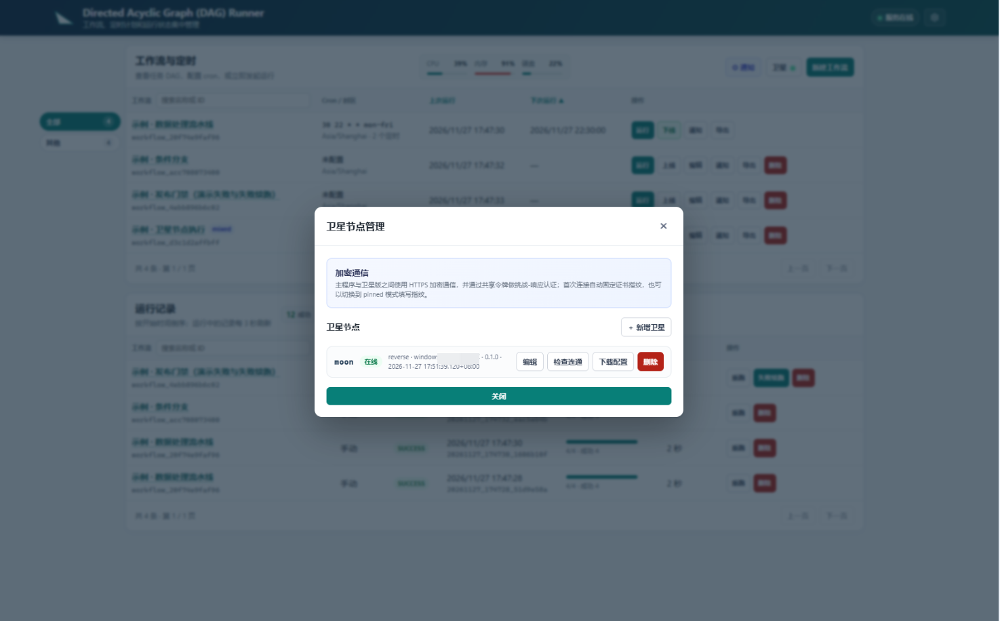

[中文](README.md) | [English](README.en.md)

# Directed Acyclic Graph (DAG) Runner

A lightweight, cross-platform Python DAG workflow runner: define tasks and dependencies in YAML, and let a single service handle scheduling, parallel execution, log monitoring, alerting, and remote satellite dispatch.



## Quick Start & Operations

### 1. Clone & Set Up Python Environment

```bash
git clone git@github.com:kbxu/DAG-Runner.git
cd DAG-Runner

conda create -n dagr python=3.11.* -y && conda activate dagr
python -m pip install -r requirements.txt
```

### 2. Initialize Config & Startup Script

Copy the templates from `var/examples/` into `var/` and adjust settings (listen port, database, satellite options, etc.) as needed:

```bash
# Linux / macOS
cp var/examples/config.example.yaml var/config.yaml
cp var/examples/start.example.sh var/start.sh
chmod +x var/start.sh

# Point the startup script to your Python interpreter (or edit var/start.sh directly)
export DAGR_PYTHON=$(which python)
```

> On Windows, copy `var\examples\config.example.yaml` and `var\examples\start.example.bat` into `var\`, and set the `DAGR_PYTHON` environment variable to your target `python.exe`.

### 3. Create the Admin Account

```bash
python -m dagrunner.server.auth --generate   # Generates the initial admin password (shown once)
```

### 4. Start, Stop, Restart & Update

```bash
# Start (supervised by watchdog by default; Web UI at http://127.0.0.1:7119)
bash var/start.sh                                      # Windows: var\start.bat

# Check watchdog and master status
python -m dagrunner.watchdog --status --role master

# Restart the master service
python -m dagrunner.watchdog --restart --role master

# Gracefully stop the master service and exit the watchdog
python -m dagrunner.watchdog --stop --role master

# Pull latest code and restart (also available in Web UI under Settings → Update)
python -m dagrunner.server.update --role master
```

> Deploying a satellite node follows the same steps: copy `var/examples/satellite.example.yaml` and `var/examples/start-satellite.example.sh` (or `.bat`) into `var/`, start with `bash var/start-satellite.sh`, and replace `--role master` with `--role satellite` in the commands above.

## Modules

See each submodule's documentation for detailed configuration options, protocols, and design notes:

| Module | Summary | Docs |
| --- | --- | --- |
| `dagrunner` | Shared core: workflow YAML parsing, cron expressions, cross-platform script wrappers, version and branch sync helpers | [dagrunner/README.md](dagrunner/README.md) |
| `server` | Master service: Web console, DAG scheduling and local execution, accounts & permissions, run archiving, online updates | [dagrunner/server/README.md](dagrunner/server/README.md) |
| `watchdog` | Process supervisor: crash backoff restarts, health checks & alerts, manual stop/restart, and update handoff for master and satellites | [dagrunner/watchdog/README.md](dagrunner/watchdog/README.md) · [Design](dagrunner/watchdog/DESIGN.md) |
| `satellite` | Satellite agent: remote task execution over forward/reverse HTTPS + token challenge-response channels with version sync | [dagrunner/satellite/README.md](dagrunner/satellite/README.md) |
| `database` | State storage: SQLite (out of the box) and MySQL 8 backends, plus scheduled archiving of finished runs | [dagrunner/database/README.md](dagrunner/database/README.md) |
| `notifier` | Notifications: SMTP email and Feishu bot channels stored in the database, with per-workflow alert routing | [dagrunner/notifier/README.md](dagrunner/notifier/README.md) |
| `tools` | CLI utilities: run/log inspection and workflow import from DolphinScheduler, Windows Task Scheduler, and Crontab | [dagrunner/tools/README.md](dagrunner/tools/README.md) |

## Minimal Workflow Example

```yaml
description: "[Data] Daily Report"
schedule:
  crons: ["30 8 * * mon-fri"]
  timezone: Asia/Shanghai
  enabled: true
tasks:
  extract:
    command: python extract.py
  transform:
    command: python transform.py
    depends: [extract]
  publish:
    command: python publish.py
    depends: [transform]
```

> Advanced options (conditional branches, per-task `runner` satellites, `setup` scripts, notification channel bindings, etc.) can be configured directly in the Web visual editor.

## Screenshots






## License

[MIT](LICENSE)
