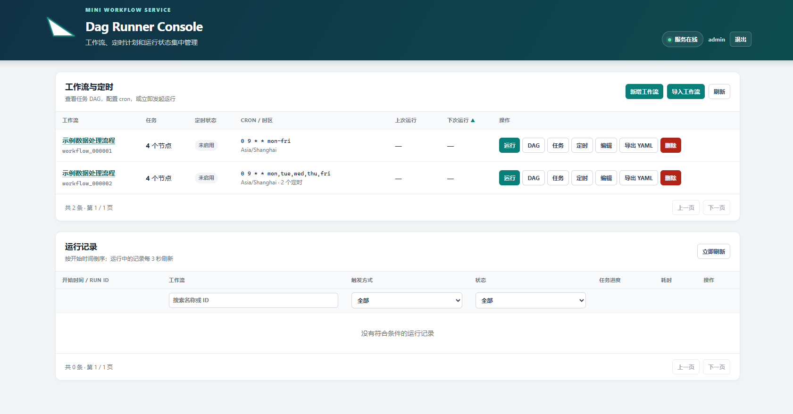
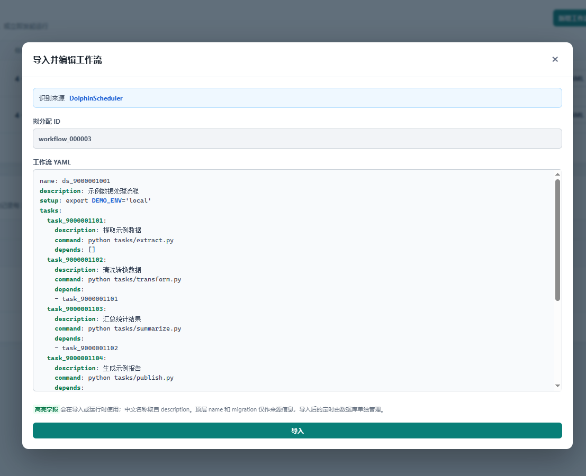
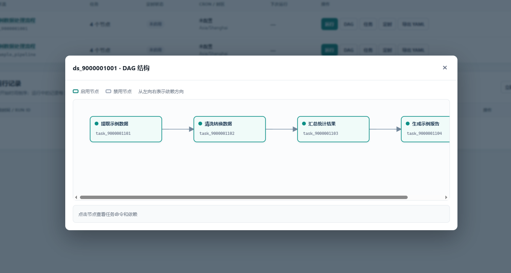
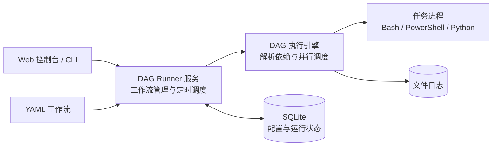

[中文](README.md) | [English](README.en.md)

# DAG Runner

一个简单、轻量、跨平台的 Python DAG 工作流运行器。

用 YAML 定义任务和依赖，启动一个服务，就可以在浏览器里配置定时、查看 DAG、运行任务、停止任务、失败续跑和查看日志。不需要为每个工作流维护系统 cron，也不需要部署分布式调度集群。





## 系统架构


## 特性

- **Cron 星期规则**：采用 Linux 编号，`0`/`7` 为周日，`1-6` 为周一至周六，也支持 `mon-sat`。例如 `40 8,23 * * 1-6` 与 `40 8,23 * * mon-sat` 等价。升级后已有数字星期配置也按此规则解释。
- **单机轻量**：Flask、SQLite 和 APScheduler 即可运行，不依赖 Redis、消息队列或外部数据库
- **方便迁移**：可把 DolphinScheduler JSON 和 Windows Task Scheduler XML 转换为 DAG Runner YAML
- **DAG 执行**：自动校验依赖和环路，并行执行就绪任务，支持停止、重跑和失败续跑
- **集中管理**：通过 Web 页面导入和编辑工作流、配置定时、查看运行 DAG 与任务日志
- **登录保护**：账号密码登录、36 小时会话，以及连续失败 3 次后按 IP 封禁 10 分钟
- **跨平台**：Linux 使用 Bash，Windows 使用 PowerShell，支持在 `setup` 中激活 Conda 环境
- **卫星节点**：在其它机器部署卫星版后端，主程序加密下发命令；支持前向/反向两种连接模式，覆盖双向、仅主→星、仅星→主三种网络拓扑

## 快速开始

### 1. 创建运行环境

推荐先使用 Conda 创建并激活独立环境，再安装项目依赖：

```bash
git clone https://github.com/kbxu/DAG-Runner.git
cd DAG-Runner
conda create -n dagr python=3.11.* -y
conda activate dagr
python -m pip install -r requirements.txt
```

### 2. 创建首次登录账号

确认上述 Conda 环境已经激活且依赖安装完成后，执行：

```bash
python -m dagrunner.auth --generate
```

DAG Runner 不提供默认密码。该命令会创建或重置管理员账号 `admin`，并且只在终端中
显示一次随机强密码，请立即妥善保存。也可以不传 `--generate`，按提示手工输入至少
16 位的密码。密码遗失时可重新执行该命令进行重置，重置后已有登录会话会立即失效。

如果启动服务时通过 `--db` 指定其他数据库文件，创建账号时必须使用相同路径，例如：

```bash
python -m dagrunner.auth --db ./var/scheduler.db --generate
```

### 3. 启动并登录

```bash
python -m dagrunner.server
```

启动后访问 <http://127.0.0.1:7119>，使用账号 `admin` 和刚生成的密码登录。数据库表会在
服务启动时自动创建，无需手工建表。

`dagrunner.server` 只接受一个参数：

| 参数 | 默认值 | 说明 |
| --- | --- | --- |
| `--config` | `var/config.example.yaml` | 启动配置 YAML 文件，其他启动参数全部从该文件读取 |

配置示例见 `var/config.example.yaml`：

```yaml
host: 127.0.0.1
port: 7119
db: var/scheduler.db
logs: var/logs
threads: 8
language: zh-CN
notifier_config: null
allow_insecure_remote_login: false
```

`notifier_config` 用于指定通知（邮件 SMTP）配置文件。`null` 是默认值，表示不指定路径：服务会在
`db` 所在目录（默认 `var/`）下自动查找 `notifier.yaml`、`notifier.yml` 或 `notifier.json`；如果都
不存在，在 Web 控制台点击“通知”保存发件配置时会自动创建 `var/notifier.yaml`。需要固定路径时也可以
显式配置，例如 `notifier_config: var/notifier.yaml`。`var/notifier.example.yaml` 只是示例模板，不会被
自动读取或更新，需要时复制为 `var/notifier.yaml` 再修改。

例如，允许局域网访问并在可信网络中使用 HTTP 登录时，在配置文件中设置：

```yaml
host: 0.0.0.0
port: 7119
db: var/scheduler.db
logs: var/logs
threads: 8
allow_insecure_remote_login: true
```

需要其它配置时可复制为 `var/config.yaml`，再通过 `--config var/config.yaml` 指定。

`var/` 下提供了两个启动脚本示例：

- Windows：`var/start.example.bat`
- Linux：`var/start.example.sh`

脚本中通过 `DAGR_PYTHON` 指定 Python 可执行文件，默认为 `python`。需要指定时编辑脚本中的
`DAGR_PYTHON`，例如 `set DAGR_PYTHON=C:\Python311\python.exe` 或
`DAGR_PYTHON=/opt/python3.11/bin/python`。运行方式：

```bash
bash var/start.example.sh
```

```bat
var\start.example.bat
```

Web 登录的密码会先在浏览器中计算 SHA-256，再由后端使用随机盐和
PBKDF2-HMAC-SHA256（600,000 次迭代）生成数据库校验值。前端摘要仍然属于可重放的
密码凭据，不能代替传输加密；非本机部署必须启用 HTTPS，并设置
`DAGRUNNER_COOKIE_SECURE=1`，确保会话 Cookie 只通过 HTTPS 发送。确需在可信局域网中
使用 HTTP 时，可在配置文件中设置 `host: 0.0.0.0` 和 `allow_insecure_remote_login: true`；该选项会允许
HTTP 会话 Cookie，并在浏览器 Web Crypto 不可用时启用页面内置的 SHA-256 实现。即使
设置了 `DAGRUNNER_COOKIE_SECURE=1`，该模式也允许 HTTP 登录，因此不应在公网环境中使用。

### 4. 定义或导入工作流

工作流使用 YAML 描述任务、依赖、准备脚本和定时配置，完整格式可参考
[示例工作流](demo/examples/dagr_example_pipeline.yaml)。登录 Web 控制台后，点击“新建工作流”，
可以选择“新增工作流”基于示例编辑，也可以选择已有文件导入。导入后的调度默认关闭，请检查命令、
依赖关系、工作目录和调度时间后再手动启用。
新工作流使用随机 hash 型 ID；如果导入任务的 ID 已被其他工作流使用，预览会为冲突任务
生成新的 hash 型 ID，并同步更新依赖和条件分支引用。

可选的 `timeout` 使用秒数。顶层 `timeout` 限制整个工作流，任务内的 `timeout` 只限制该任务；
超时后会终止正在运行的任务进程树。字段不写时不设置超时：

```yaml
timeout: 3600
tasks:
  generate_report:
    command: python report.py
    timeout: 600
```

“新建工作流”弹窗可以直接识别以下格式：

- DAG Runner YAML
- DolphinScheduler 导出的 JSON，例如 [示例文件](demo/examples/ds_9000001001.json)
- Windows 任务计划程序导出的 XML，例如 [示例文件](demo/examples/ts_market_report.xml)

DolphinScheduler 和 Windows 文件会使用默认参数在内存中转换，编辑框顶部会标记识别到的
来源，不会生成中间文件。一个 Windows 任务中的多个可转换日历触发器会保留在同一个工作流
中，并共享一个时区。

目前 DolphinScheduler 转换仅支持 `SHELL`（Bash）和 `CONDITIONS` 两类节点；其他类型会被
省略，并在导入预览中提示人工检查。

#### 需要附加环境参数时手动转换

如果迁移时需要注入工作目录、Conda 环境或环境变量，可以先使用命令行手动转换。例如：

```bash
python -m dagrunner.migrate_workflows \
  --source dolphinscheduler \
  data/ds_workflow.json \
  --setup-file templates/production_setup.sh
```

Windows 任务计划程序使用 `--source windows-task-scheduler`，并传入导出的 XML 文件；
PowerShell 环境准备脚本可以使用 `--setup-file templates/production_setup.ps1`。转换完成后，
再从 Web 控制台导入生成的 `dagr_<源文件名>.yaml`。

手动转换可用参数：

| 参数 | 是否必填 | 说明 |
| --- | --- | --- |
| `--source` | 是 | `dolphinscheduler` 或 `windows-task-scheduler` |
| `EXPORT` | 是 | 一个或多个 JSON/XML 导出文件路径；这是位置参数，不要输入字面量 `EXPORT` |
| `--output-dir` | 否 | YAML 输出目录；默认写入源文件所在目录 |
| `--setup-file` | 否 | 注入工作流级准备脚本；`.ps1`/`.psm1` 按 PowerShell 处理，其余按 Bash 处理 |
| `--exclude-disabled` | 否 | 不转换已禁用节点及与其相连的依赖边 |
| `--timezone` | 否 | 时区，默认 `Asia/Shanghai`；主要用于转换 Windows 触发器 |

转换过程只读写配置，不会执行导出文件中的命令。

## CLI

```bash
# 运行工作流
python -m dagrunner --workflow workflow_a1b2c3d4e5f6

# 查看历史
python -m dagrunner --workflow workflow_a1b2c3d4e5f6 --list-runs

# 从指定失败任务继续
python -m dagrunner --workflow workflow_a1b2c3d4e5f6 --from transform_data

# 查看任务日志
python -m dagrunner --show-log --run-id <run_id> --task transform_data
```

## 卫星节点（跨机器执行）

卫星版是部署在目标机器上的独立后端，接收主程序下发的命令并在本机执行：Linux 默认 bash，Windows 默认 cmd。主程序与卫星版之间使用 HTTPS 加密通信，并通过共享令牌做挑战-响应认证；首次连接自动固定证书指纹，也可以切换到 pinned 模式填写指纹。

三种网络拓扑都支持：

| 拓扑 | 可达性 | 采用模式 | 连接发起方 |
| --- | --- | --- | --- |
| 1 | 双向可达 | 反向（优先） | 卫星版 |
| 2 | 仅主程序 → 卫星 | 前向 | 主程序 |
| 3 | 仅卫星 → 主程序 | 反向 | 卫星版 |

### 1. 主程序启用卫星服务

在 `var/config.yaml` 中启用（首次启动自动生成自签名证书）：

```yaml
satellite:
  enabled: true
  host: 0.0.0.0
  port: 7120
  # 主程序侧证书，首次启动自动生成
  cert: var/master-certs/cert.pem
  key: var/master-certs/key.pem
  # 卫星版回连主程序的地址，留空按 Web 请求 Host 推导
  public_url: ""
```

### 2. 在 Web 控制台添加卫星节点

登录后点击顶部「卫星」按钮，新增卫星节点：填写别名、模式、URL（前向模式）和共享令牌（留空自动生成），点击「检查连通」验证配置，然后「下载配置」得到可直接下发的 `satellite.yaml`。

### 3. 在目标机器启动卫星版

```bash
python -m dagrunner.satellite --config var/satellite.yaml
```

主程序与卫星版的证书分目录存放，互不干扰：主程序在 `var/master-certs/`，卫星版在 `var/satellite-certs/`（卫星的信任记录 `known_master.json` 也在这里）。迁移卫星时把 `var/satellite-certs/` 整个目录拷到新机器即可，不用重新签发证书。

把工作流的「运行位置」设置为该卫星别名，任务就会在卫星机器上执行，日志实时回传到主程序。卫星版默认 `auto` 模式：能连上主程序就用反向模式，连不上就监听前向连接，网络恢复后自动切换。

### 4. 指定运行位置（workflow 级 / task 级）

运行位置可以写在 workflow YAML 里，支持两级，**task 级优先**：

```yaml
runner: sat-01          # workflow 级默认；不写就是本机
tasks:
  extract:
    command: python extract.py
  report:               # 不写 runner，跟随 workflow 默认（sat-01）
    command: python report.py
  notify:
    command: python notify.py
    runner: local       # 覆盖 workflow 默认，强制在本机执行
```

- 都不写 → 全部在本机执行。
- workflow 写了、task 没写 → 跟随 workflow。
- task 写了 → 以 task 为准。
- 卫星不可达或不存在时，对应任务直接失败并在日志/错误信息里说明原因。

Web 控制台编辑工作流时的「运行位置」下拉框对应 workflow 级 `runner`（保存时写入 YAML 顶层）。DAG 视图中，在卫星上运行的节点右上角会标注卫星别名；工作流列表和运行记录标题旁的标签会汇总运行地点：全部本机留空、单一卫星显示别名、混合显示 `mixed`（hover 可查看各地点的任务数）。

## 项目结构

```text
dagrunner/        核心代码、Web 页面和静态资源
  satellite.py          卫星版启动入口
  satellite_agent.py    卫星版进程与执行器
  satellite_master.py   主程序侧卫星管理器与 7120 端点
  satellite_protocol.py 协议类型、任务规范与脚本构建
  satellite_crypto.py   证书、TLS、nonce 与 HMAC 认证
  satellite_http.py     卫星协议 HTTPS 客户端
  satellite_server.py   waitress + 进程内 TLS 终结
demo/tasks/       可安全运行的虚构示例任务脚本
demo/examples/    ds_*.json、ts_*.xml 和 dagr_*.yaml 公开示例
templates/        Bash 和 PowerShell 生产 setup 模板
data/             私有迁移数据，Git 忽略
var/              SQLite、日志、卫星证书和本地运行数据，Git 忽略
docs/images/      README 首页图片
```

## 部署与安全

服务默认只监听 `127.0.0.1`。开放到局域网或互联网前，请通过反向代理增加身份认证和 HTTPS。工作流 YAML 可以执行系统命令，应当按可信代码管理，并使用低权限服务账户运行。

操作系统只需负责常驻 `python -m dagrunner.server` 进程；具体工作流定时由服务内部管理。

## License

[MIT](LICENSE)
