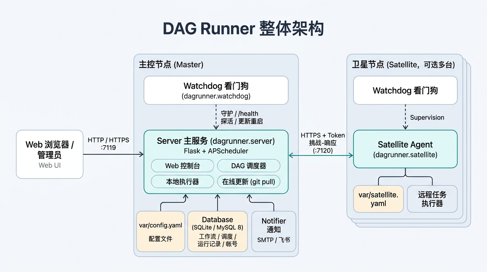
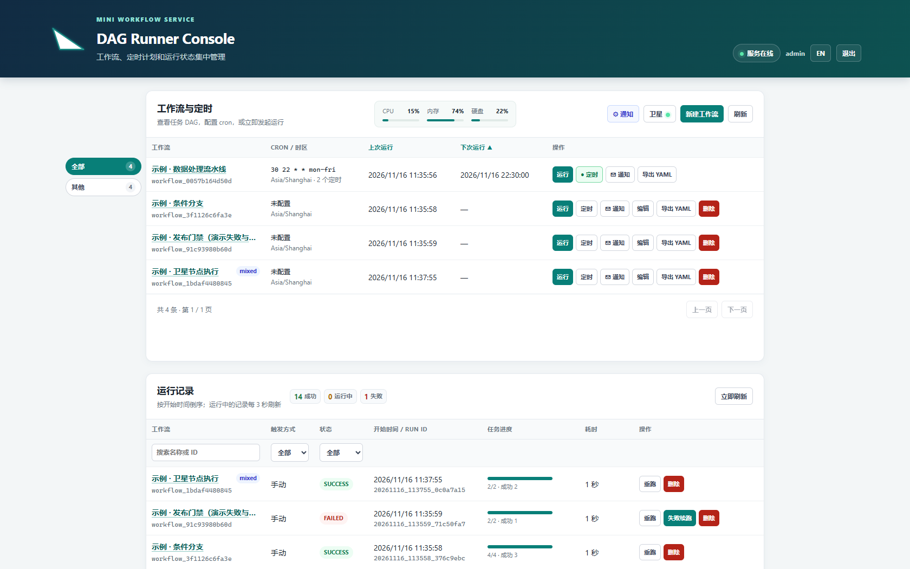
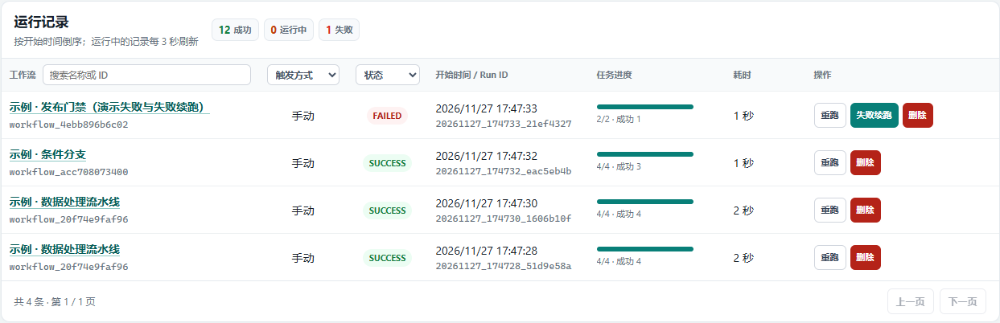

[中文](README.md) | [English](README.en.md)

# Directed Acyclic Graph (DAG) Runner

轻量、跨平台的 Python DAG 工作流运行器：用 YAML 描述任务与依赖，单服务完成定时调度、并行执行、日志监控、告警通知与卫星节点远程分发。



## 快速部署与运维

### 1. 拉取代码与配置 Python 环境

```bash
git clone git@github.com:kbxu/DAG-Runner.git
cd DAG-Runner

conda create -n dagr python=3.11.* -y && conda activate dagr
python -m pip install -r requirements.txt
```

### 2. 初始化配置与启动脚本

将 `var/examples/` 下的模板复制到 `var/`，再按需修改配置（如监听端口、数据库、卫星开关等）：

```bash
# Linux / macOS
cp var/examples/config.example.yaml var/config.yaml
cp var/examples/start.example.sh var/start.sh
chmod +x var/start.sh

# 指定启动脚本使用的 Python（也可以直接写进 var/start.sh）
export DAGR_PYTHON=$(which python)
```

> Windows 复制 `var\examples\config.example.yaml` 与 `var\examples\start.example.bat` 到 `var\`，并设置环境变量 `DAGR_PYTHON` 指向目标 `python.exe`。

### 3. 创建管理员账号

```bash
python -m dagrunner.server.auth --generate   # 生成 admin 初始密码（仅显示一次）
```

### 4. 启动、停止、重启与更新

```bash
# 启动（默认通过 watchdog 守护主服务，访问 http://127.0.0.1:7119）
bash var/start.sh                                      # Windows: var\start.bat

# 查看看门狗与主服务状态
python -m dagrunner.watchdog --status --role master

# 重启主服务
python -m dagrunner.watchdog --restart --role master

# 优雅停止主服务并退出看门狗
python -m dagrunner.watchdog --stop --role master

# 在线拉取代码并重启（也可在 Web 右上角「设置 → 更新」中操作）
python -m dagrunner.server.update --role master
```

> 卫星节点部署方式相同：复制 `var/examples/satellite.example.yaml` 和 `var/examples/start-satellite.example.sh`（或 `.bat`）到 `var/`，用 `bash var/start-satellite.sh` 启动，运维命令将 `--role master` 改为 `--role satellite` 即可。

## 模块说明

详细配置项、协议与设计细节请查看对应子模块文档：

| 模块 | 职责简介 | 文档 |
| --- | --- | --- |
| `dagrunner` | 共享内核：工作流 YAML 解析、cron 表达式、跨平台脚本封装、版本与分支同步工具 | [dagrunner/README.md](dagrunner/README.md) |
| `server` | 主控服务：Web 控制台、DAG 调度与本地执行、账号权限、运行记录归档、在线更新 | [dagrunner/server/README.md](dagrunner/server/README.md) |
| `watchdog` | 进程看门狗：守护主服务与卫星，崩溃退避重启、假死探活告警、启停与更新接管 | [dagrunner/watchdog/README.md](dagrunner/watchdog/README.md) · [设计文档](dagrunner/watchdog/DESIGN.md) |
| `satellite` | 卫星节点：远程任务执行代理，支持前向 / 反向 HTTPS + 令牌挑战-响应加密通信与版本同步 | [dagrunner/satellite/README.md](dagrunner/satellite/README.md) |
| `database` | 状态存储：SQLite（开箱即用）与 MySQL 8 双后端、终态运行记录定期归档 | [dagrunner/database/README.md](dagrunner/database/README.md) |
| `notifier` | 告警通知：邮件（SMTP）与飞书自定义机器人，支持多渠道存库配置与失败/恢复分发 | [dagrunner/notifier/README.md](dagrunner/notifier/README.md) |
| `tools` | 命令行工具：运行记录与日志查询，以及 DolphinScheduler / Windows 计划任务 / Crontab 导入 | [dagrunner/tools/README.md](dagrunner/tools/README.md) |

## 工作流示例

```yaml
description: 【数据】每日报表
schedule:
  crons: ["30 8 * * mon-fri"]
  timezone: Asia/Shanghai
  enabled: true
tasks:
  extract:
    command: python extract.py
  transform:
    command: python transform.py
    depends: [extract]
  publish:
    command: python publish.py
    depends: [transform]
```

> 更多字段（条件分支、单任务指定 `runner` 卫星、`setup` 环境准备、多渠道通知绑定等）可在 Web 表单编辑器中直接可视化配置。

## 界面预览






## License

[MIT](LICENSE)
