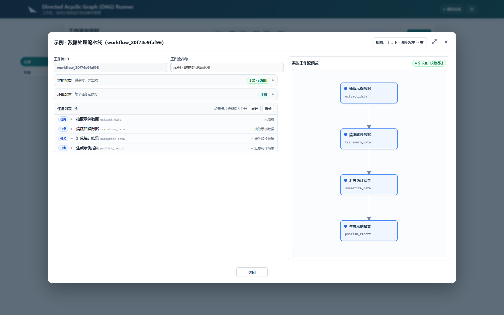
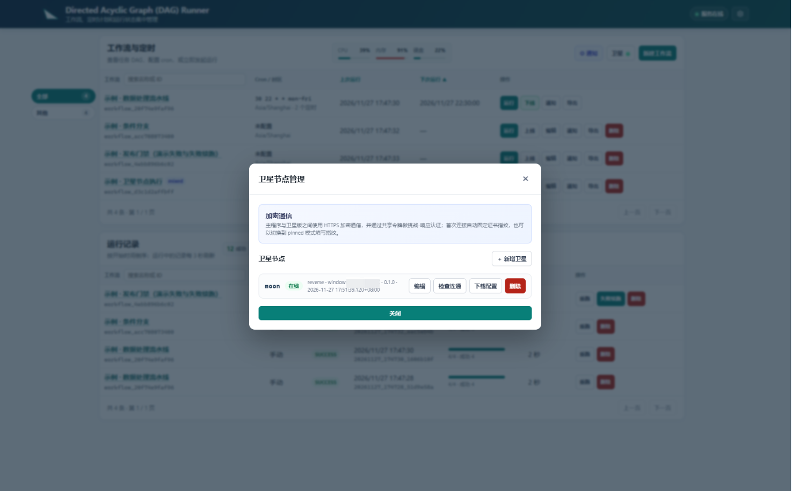

[中文](README.md) | [English](README.en.md)

# Directed Acyclic Graph (DAG) Runner

轻量、跨平台的 Python DAG 工作流运行器：用 YAML 描述任务与依赖，一个常驻服务负责定时调度、执行、监控与日志。






## 特性

- **轻量单机**：Flask + SQLite + APScheduler，不需要 Redis、消息队列或外部数据库；也可在配置里选用 MySQL 8
- **DAG 执行**：自动校验依赖与环路，并行执行就绪任务，支持停止、重跑、失败续跑
- **定时调度**：Linux 风格 cron（`0`/`7` 为周日），支持多条 cron 与任意时区
- **跨平台**：Linux 用 bash，Windows 用 cmd，也可指定 PowerShell
- **卫星节点**：在其它机器部署卫星版，主程序加密下发命令，支持前向/反向两种连接模式
- **Web 管理**：导入编辑工作流、查看 DAG 与日志、邮件通知
- **迁移导入**：DolphinScheduler JSON、Windows 计划任务 XML 一键转成 YAML
- **安全防护**：账号密码登录、失败封禁，卫星通信用 HTTPS + 令牌挑战-响应

## 快速开始

```bash
conda create -n dagr python=3.11.* -y && conda activate dagr
python -m pip install -r requirements.txt
```

```bash
python -m dagrunner.auth --generate   # 创建 admin 账号，随机密码只显示一次
```

```bash
python -m dagrunner.server            # 启动服务，访问 http://127.0.0.1:7119
```

## 工作流

最小示例：

```yaml
description: 每日数据报表
schedule:
  crons: ["30 8 * * mon-fri"]
  timezone: Asia/Shanghai
  enabled: true
tasks:
  extract:
    command: python extract.py
  transform:
    command: python transform.py
    depends: [extract]
  publish:
    command: python publish.py
    depends: [transform]
```

### 运行位置

顶层 `runner` 是 workflow 级默认，任务级 `runner` 优先；都不写就是本机。

```yaml
runner: moon                     # workflow 级默认
tasks:
  on_satellite:
    command: echo hello
  local_check:
    command: echo check
    runner: local                # 覆盖为本地
```

### 字段速查

| 字段 | 说明 | 默认 |
| --- | --- | --- |
| `description` | 显示名称 | 文件名 |
| `setup` | 任务前的环境准备，可按平台分开写 | 空 |
| `timeout` | 整个 workflow 的超时（秒） | 不限 |
| `schedule.crons` | 多条 cron 表达式 | 无 |
| `schedule.timezone` | 时区 | `Asia/Shanghai` |
| `notification.email` | 邮件通知开关与收件人 | 关闭 |
| `runner` | workflow 级默认运行位置 | `local` |
| `tasks.<id>.command` | 命令（字符串或数组） | 必填 |
| `tasks.<id>.args` | 附加参数 | 空 |
| `tasks.<id>.shell` | `bash` / `sh` / `cmd` / `powershell` | 按平台 |
| `tasks.<id>.depends` | 依赖任务 | 空 |
| `tasks.<id>.timeout` | 单任务超时（秒） | 不限 |
| `tasks.<id>.runner` | 该任务的运行位置 | 跟随 workflow |
| `tasks.<id>.condition` | 条件分支（`type: condition`） | 无 |

## 卫星节点

在目标机器部署卫星版，主程序把命令加密下发过去执行。三种网络拓扑都支持：

| 拓扑 | 可达性 | 模式 | 连接发起方 |
| --- | --- | --- | --- |
| 1 | 双向可达 | 反向（优先） | 卫星 |
| 2 | 仅主程序 → 卫星 | 前向 | 主程序 |
| 3 | 仅卫星 → 主程序 | 反向 | 卫星 |

**1. 主程序启用**（`var/config.yaml`）：

```yaml
satellite:
  enabled: true
  host: 0.0.0.0
  port: 7120
  cert: var/master-certs/cert.pem
  key: var/master-certs/key.pem
  public_url: ""      # 卫星回连地址，留空按 Web 请求 Host 推导
```

**2. 添加节点**：Web 控制台点「卫星」→ 新增，填别名、模式、URL（前向）、令牌（留空自动生成）；「检查连通」验证后「下载配置」。

**3. 启动卫星**：

```bash
python -m dagrunner.satellite --config var/satellite.yaml
```

**证书目录**：主程序用 `var/master-certs/`，卫星用 `var/satellite-certs/`（含信任记录 `known_master.json`）。迁移卫星直接拷 `var/satellite-certs/` 整个目录。

**版本一致**：主程序与卫星必须使用完全相同的 `dagrunner.__version__`。注册时校验，不一致就断开：反向模式卫星停止重连，前向模式任务直接失败，Web 上的「检查连通」也会提示版本不一致。

## 配置速查

| 配置项 | 说明 | 默认 |
| --- | --- | --- |
| `host` / `port` | Web 监听地址 | `127.0.0.1:7119` |
| `db` / `logs` | 数据库（SQLite 路径，或 MySQL 8 的 map 配置）与日志目录 | `var/scheduler.db` / `var/logs` |
| `threads` | Web 线程数 | `8` |
| `notifier_config` | 邮件配置路径 | 自动查找 `var/notifier.yaml` |
| `allow_insecure_remote_login` | 允许 HTTP 登录（仅可信内网） | `false` |
| `satellite.enabled` | 启用卫星服务 | `false` |
| `satellite.host` / `port` | 卫星服务监听地址 | `0.0.0.0:7120` |
| `satellite.public_url` | 卫星回连主程序的地址 | 按请求推导 |

CLI（`python -m dagrunner`、`python -m dagrunner.auth`、`python -m demo.init_demo`）加 `--db-config var/config.yaml` 即可复用上面的 `db` 配置；不传时仍用 `--db` 指定的 SQLite 文件。

## 常用命令

| 命令 | 说明 |
| --- | --- |
| `python -m dagrunner --workflow <id>` | 运行工作流 |
| `python -m dagrunner --workflow <id> --from <task>` | 从指定任务运行 |
| `python -m dagrunner --workflow <id> --list-runs` | 查看历史 |
| `python -m dagrunner --show-log --run-id <id> --task <task>` | 查看日志 |
| `python -m dagrunner.auth --generate` | 创建 / 重置登录账号 |
| `python -m dagrunner.migrate_workflows --source <ds\|windows-task-scheduler> ...` | 导入外部任务 |
| `python -m dagrunner.satellite --config <path>` | 启动卫星版 |
| `python -m demo.init_demo --reset` | 生成演示数据 |

## 项目结构

```text
dagrunner/        核心代码与 Web 资源
  server.py         主服务入口（Web + 卫星服务）
  satellite.py      卫星版入口        satellite_*.py  卫星协议 / 加密 / 执行
  workflow.py       工作流解析与校验   runner.py        DAG 执行引擎
  service.py        调度与运行管理     database*.py   状态存取（SQLite / MySQL 8）
demo/             示例工作流、任务脚本与演示数据初始化
docs/images/      README 截图
var/              数据库、日志、证书（本地数据）
```

## 安全

- Web 默认只监听 `127.0.0.1`；开放到公网请用反向代理加 HTTPS
- 卫星通道用自签名证书 + 指纹固定（首次自动固定，可改 pinned）与共享令牌挑战-响应
- 任务请以低权限账户运行

## License

[MIT](LICENSE)
